# BÁO CÁO THỰC HIỆN TASK TV1

Chuẩn bị dữ liệu và xây dựng các cấu hình tiền xử lý cho TVPL (tiếng Việt) và NFCorpus (tiếng Anh).

Ngày lập: 17/10/2026. Thư mục dự án: D:\DataPipeline.

Phạm vi TV1 trong tài liệu được xác định theo code và README của dự án. Hình minh họa được dựng từ code, dữ liệu và báo cáo thật; đây không phải ảnh chụp trực tiếp giao diện CMD. Kết quả kiểm tra mẫu và chuẩn hóa được chạy lại trong phiên lập báo cáo; kết quả kiểm tra toàn bộ được ghi theo báo cáo validation trong dự án.

# 1. Danh sách công việc đã thực hiện

| STT | Công việc | Sản phẩm |
|---|---|---|
| 1 | Chuẩn bị dữ liệu TVPL và NFCorpus | data/raw |
| 2 | Thống nhất schema và kiểm tra liên kết ID | data/canonical/vi và en |
| 3 | Xây dựng hàm tiền xử lý | src/preprocess.py |
| 4 | Kiểm tra câu mẫu và trường hợp đặc biệt | preprocessing_examples, sample_validation |
| 5 | Tạo năm cấu hình cho hai ngôn ngữ | data/processed/vi và en |
| 6 | Kiểm tra dữ liệu và chuẩn bị bàn giao | validation_report, build_manifest, handoff |

# 2. Thực hiện từng bước

## Bước 1. Mở CMD và chuẩn bị môi trường

Mở Command Prompt trên Windows. Chạy lần lượt các lệnh dưới đây. Nếu .venv đã tồn tại thì bỏ qua lệnh tạo môi trường. Các lệnh dùng trực tiếp Python trong .venv nên không cần activate.

```bat
cd /d D:\DataPipeline
python -m venv .venv
.\.venv\Scripts\python.exe -m pip install -r requirements.txt
```

Vai trò: cài các thư viện đọc dữ liệu và xử lý ngôn ngữ, gồm Underthesea và NLTK. Dự án hiện đã có môi trường chạy được; quá trình cài đặt không được chạy lại để tạo bằng chứng giả.

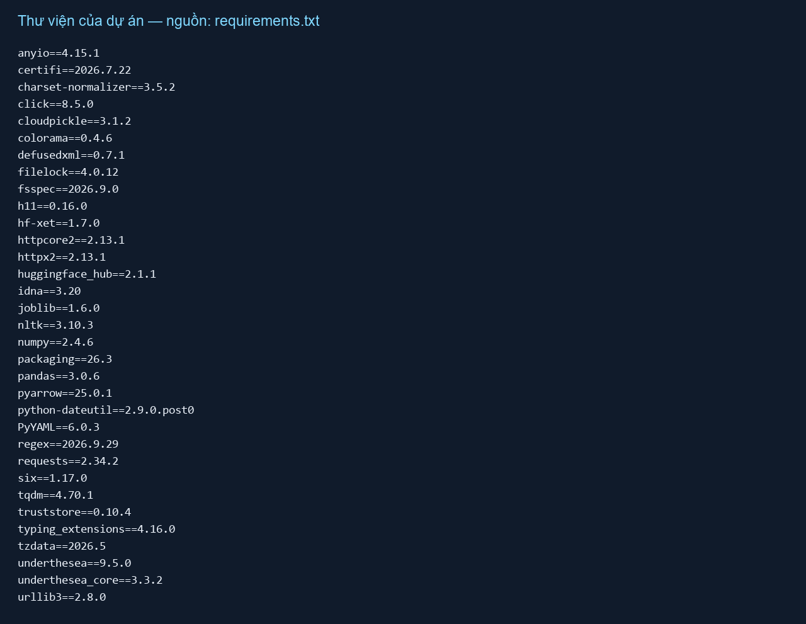

Ảnh CMD cần chụp khi tự thực hiện: lệnh cài thư viện cùng thông báo hoàn tất. Không dùng hình danh sách thư viện để thay cho bằng chứng cài thành công.

## Bước 2. Chuẩn hóa cấu trúc dữ liệu

```bat
.\.venv\Scripts\python.exe src\prepare_data.py
```

Script đọc dữ liệu đã có trong data/raw, ghép title và text bằng một ký tự xuống dòng khi có nội dung, đổi tên ID và xuất UTF-8. Bước này không lowercase, không loại stopword và không tách từ. NFCorpus chỉ giữ các query có ID trong qrels test.

Đầu ra mỗi ngôn ngữ gồm corpus.jsonl với doc_id/text, queries.jsonl với query_id/text và qrels.csv với query_id/doc_id/relevance. Script kiểm tra ID duy nhất, tham chiếu qrels, đọc lại file xuất và hash dữ liệu gốc.

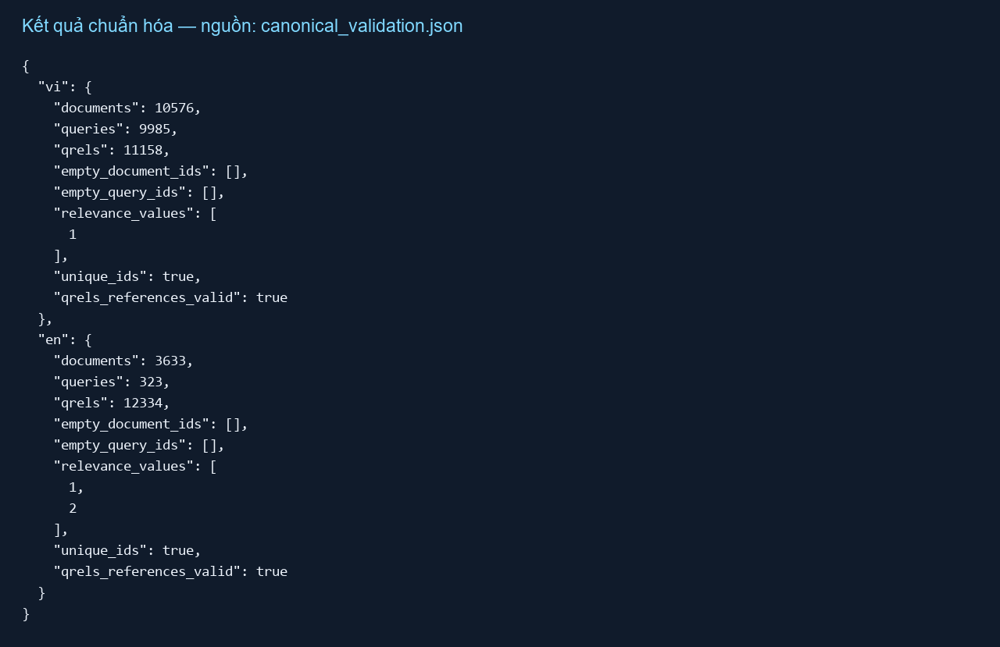

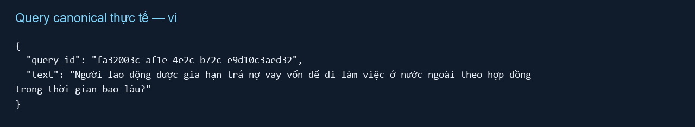

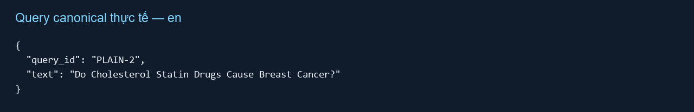

Ảnh CMD cần chụp: dòng thống kê vi và en sau lệnh prepare_data.py. Ảnh đầu ra: mở data/canonical và một bản ghi JSONL trong VS Code.

## Bước 3. Giải thích code tiền xử lý

| Cấu hình | Quy tắc |
|---|---|
| original | Giữ nguyên canonical, gồm phần title đã ghép. |
| stopword | Loại từ/cụm từ dừng; khớp không phân biệt hoa thường, ưu tiên cụm dài. |
| normalize | Lowercase; giữ chữ Unicode, dấu kết hợp và số; thay phần còn lại bằng khoảng trắng rồi gộp. |
| tokenize | VI: Underthesea; EN: TreebankWordTokenizer của NLTK. |
| combined | normalize → tokenize → remove stopwords. |

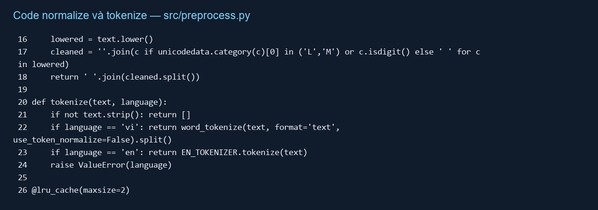

normalize xử lý từng ký tự theo nhóm Unicode để giữ dấu tiếng Việt. tokenize trả về danh sách token; tiếng Việt có thể nối từ nhiều âm tiết bằng dấu gạch dưới. Treebank có thể tách contractions của tiếng Anh.

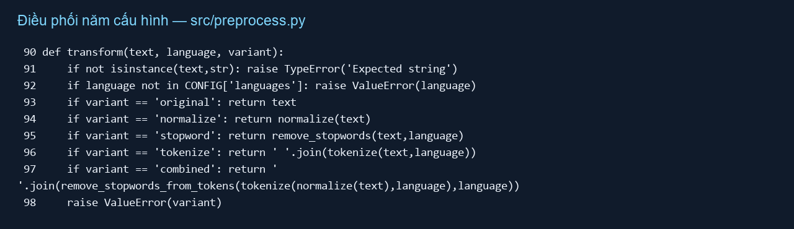

Stopword gốc nằm tại resources/stopwords/vi.txt và en.txt; nguồn và checksum được ghi trong sources.json. Ở combined, danh sách stopword cũng được normalize và tokenize để so khớp nhất quán với văn bản. Không loại bản ghi khi kết quả rỗng.

## Bước 4. Chạy thử trên câu mẫu

```bat
.\.venv\Scripts\python.exe src\check_samples.py
```

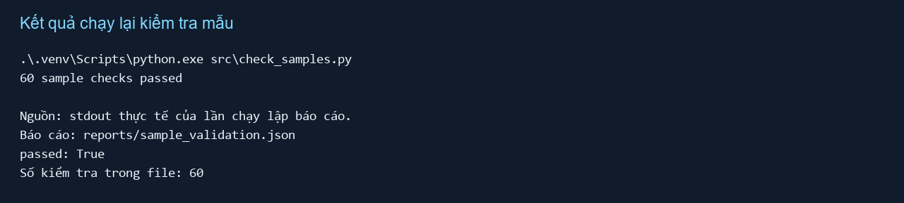

Kiểm tra bao gồm Unicode, dấu câu, ranh giới từ, cụm stopword nhiều âm tiết, token có gạch dưới, câu rỗng và tính ổn định của normalize. Báo cáo ví dụ lưu tại reports/preprocessing_examples.md và .csv.

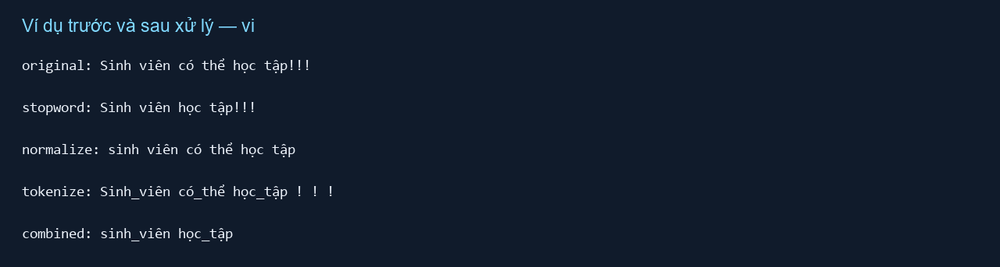

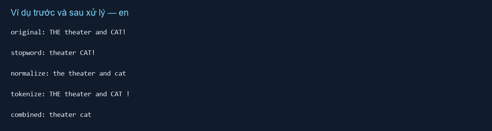

## Bước 5. Sinh toàn bộ năm cấu hình

```bat
.\.venv\Scripts\python.exe src\build_variants.py
```

Script lặp qua hai ngôn ngữ, năm cấu hình và hai loại dữ liệu corpus/queries. Mỗi bản ghi được transform rồi ghi JSONL; giữ nguyên ID và thứ tự. qrels.csv được sao chép một lần cho mỗi ngôn ngữ. Lệnh này ghi lại dữ liệu processed và có thể chạy lâu do tách từ toàn bộ dữ liệu.

Trong phiên lập báo cáo, bước build dùng các file đã có; không mô tả là đã build lại. Log thực tế khi tự chạy thường có dạng “vi original corpus done 10576”; cần chụp log từ lần chạy của bạn.

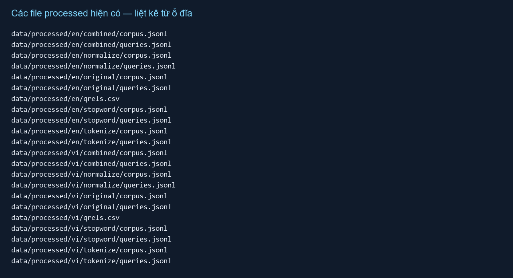

Thành phẩm gồm 20 file JSONL (2 ngôn ngữ × 5 cấu hình × 2 loại) và 2 file qrels.csv dùng chung ở cấp ngôn ngữ. Thống kê số lượng, độ dài và thời gian build nằm tại reports/dataset_summary.csv; phiên bản thư viện và hash nằm tại reports/build_manifest.json.

## Bước 6. Kiểm tra toàn bộ và bàn giao

```bat
.\.venv\Scripts\python.exe src\validate_data.py
```

Script kiểm tra schema, ID, liên kết qrels, hash đầu vào/đầu ra, tính lại toàn bộ phép transform và so sánh nội dung từng bản ghi. Phải đợi tiến trình kết thúc; chỉ khi hoàn tất thành công mới có dòng “Full validation passed”.

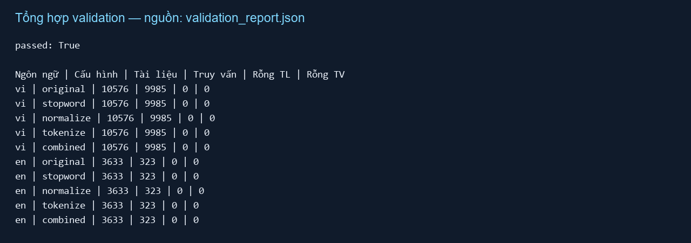

Bàn giao data/processed, config.json, nguồn stopword và các báo cáo. Người làm truy xuất cần thống nhất cách đọc token, giữ token ghép tiếng Việt và tránh áp dụng thêm lowercase/stopword ngoài cấu hình đã chọn. Người đánh giá dùng cùng tập query và mức relevance gốc cho mọi cấu hình.

# 3. Thành quả

| Bộ dữ liệu | Tài liệu | Truy vấn | Qrels | Cấu hình |
|---|---|---|---|---|
| TVPL / vi | 10576 | 9985 | 11158 | 5 |
| NFCorpus / en | 3633 | 323 | 12334 | 5 |

| Ngôn ngữ | Cấu hình | Tài liệu | Truy vấn | TL rỗng | TV rỗng |
|---|---|---|---|---|---|
| vi | original | 10576 | 9985 | 0 | 0 |
| vi | stopword | 10576 | 9985 | 0 | 0 |
| vi | normalize | 10576 | 9985 | 0 | 0 |
| vi | tokenize | 10576 | 9985 | 0 | 0 |
| vi | combined | 10576 | 9985 | 0 | 0 |
| en | original | 3633 | 323 | 0 | 0 |
| en | stopword | 3633 | 323 | 0 | 0 |
| en | normalize | 3633 | 323 | 0 | 0 |
| en | tokenize | 3633 | 323 | 0 | 0 |
| en | combined | 3633 | 323 | 0 | 0 |

Các hình 02–03 thể hiện dữ liệu canonical; hình 04–05 giải thích code; hình 06 thể hiện kiểm tra mẫu đã chạy; hình 07 thể hiện thay đổi văn bản; hình 08 thể hiện file đầu ra; hình 09 thể hiện báo cáo validation. Các số liệu là từ dữ liệu và báo cáo dự án, không phải số liệu minh họa.

Giới hạn: TVPL và NFCorpus khác miền nội dung nên không thể quy chênh lệch điểm giữa hai bộ chỉ cho ngôn ngữ. Chưa chạy TF-IDF/BM25, chưa có điểm truy xuất và chưa thử tích hợp với code thành viên tiếp theo. Danh sách stopword tiếng Việt rộng có thể loại từ mang thông tin pháp luật; không điều chỉnh quy tắc dựa trên điểm test.

# 4. Danh sách ảnh CMD cần bổ sung nếu yêu cầu ảnh chụp màn hình trực tiếp

Tài liệu đã có hình minh họa dữ liệu/code thật. Nếu giảng viên yêu cầu ảnh giao diện CMD, mở CMD, chạy lần lượt các lệnh ở phần 2 và dùng Win + Shift + S để chụp sau từng lệnh: cài thư viện; prepare_data.py; check_samples.py; build_variants.py; validate_data.py. Chụp thêm cây thư mục processed và ví dụ JSONL. Giữ rõ cả lệnh lẫn kết quả; chỉ chụp khi tiến trình hoàn tất. Các hình dựng trong báo cáo không được ghi là ảnh chụp CMD.
